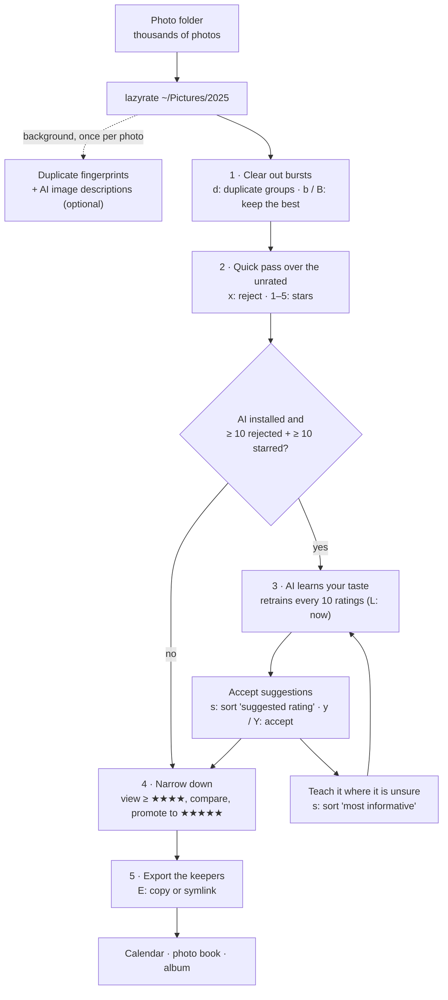

# lazyrate

Terminal UI to rate thousands of photos fast and keep only the best ones (e.g. for a year calendar).

## Why

A year of phone and camera photos easily means thousands of files spread over many folders, with bursts and
near-identical shots. Picking the twelve best for a calendar (or the fifty best for a photo book) in a file browser is
slow: you lose track of what you already looked at, and there is no place to keep the verdicts.

lazyrate turns this into a keyboard-only pass: one key per photo (`1`–`5` stars, `0` reject), previews right in the
terminal, ratings saved instantly in a small database next to the photos. Afterwards you review by rating (only the
5-star ones, only the unrated), weed out near duplicates, and export the keepers to a separate folder. Your photos
themselves are never touched.


<sub>Screenshot taken headless with generated demo images, so the thumbnails use the block-character fallback. In
terminals with a graphics protocol (Ghostty, Kitty, WezTerm, iTerm2) they are shown at full resolution.</sub>

## Use cases

| You want to … | lazyrate helps by … |
| --- | --- |
| **Pick the 12 best photos of the year for a calendar** (or 50 for a photo book) | fast one-key rating, review only the ★★★★★, one section per month, export the keepers |
| **Clean up a phone camera roll** | grouping bursts and near duplicates (`b` keeps one), AI flags screenshots, receipts and pocket shots as junk, `Y` rejects them in one go |
| **Curate a trip album or slideshow** | sort by date taken, rate, export ≥ ★★★★ by copy or symlink, flat or with folders |
| **Find that one photo** | AI text search: `/` → "dog in snow" |
| **Keep up with new photos** | ratings stay with the folder; rescan, only new photos are unrated, the AI already knows your taste |

lazyrate never deletes or modifies photos. Rejected photos are just marked; to clean up, export them
(`lazyrate export ROOT ~/to-delete --rating 0 --symlink`) and decide there.

## How it works



1. **Start** lazyrate on a folder. It scans all sub folders and, in the background (with progress bars),
   fingerprints every photo for duplicate detection and — with the AI extra — describes its content once.
2. **Clear out bursts** in duplicates mode: keep the best shot of each group with one key.
3. **Rate quickly**: one key per photo, the list doesn't jump while you rate, `z` undoes.
4. **Let the AI help** (optional): after a few dozen ratings it suggests ratings for the rest; you accept them
   per photo or per section, and teach it by rating the photos it is least sure about.
5. **Narrow down and export**: view only the best, compare in the grid or full view, export.

## Features

- Recursively scans a folder (hidden folders and NAS metadata like `@eaDir` are skipped)
- Real image previews in the terminal: Kitty graphics protocol (Ghostty, Kitty, WezTerm), Sixel (iTerm2, foot, …), unicode fallback elsewhere
- Background decoding + prefetch of the next images, JPEG draft-mode decoding (24 MP → ~25 ms), EXIF orientation, HEIC/HEIF
- Ratings stored immediately in SQLite (`ROOT/.lazyrate.sqlite`), keyed by path relative to the root, so the folder can be moved
  (a `.imgrate.sqlite` from before the rename to lazyrate is renamed automatically, ratings are kept)
- Sort by path, rating (best first) or date taken
- Near-duplicate detection (bursts, re-saved or resized copies): perceptual hash computed once in the background
  and cached in SQLite; review one group at a time and keep the best with a single key
- Review any rating bucket (unrated, rejected, ≥ N stars, any combination) in single view or as a thumbnail grid
- Export from the app (`E`) or the shell, by copy or symlink, flat or with sub folders
- Choose which file formats take part (images on by default; `.mp4`, `.mov`, RAW etc. off unless you enable them)
- Optional AI: suggested ratings learned from **your own** ratings (junk 0 and 1–5 stars), "rate where it learns
  most", text search ("beach sunset"), best-of-burst hints — all local, nothing is uploaded
- Progress bars for everything that runs in the background

## Quick start

Try it without cloning or installing anything (needs [uv](https://docs.astral.sh/uv/)):

```sh
uvx --from git+https://github.com/wrichert/lazyrate lazyrate ~/Pictures/2025
# with AI suggestions and search (~600 MB torch + 605 MB CLIP model on first start; ~400 photos/s on Apple GPUs):
uvx --from 'lazyrate[ml] @ git+https://github.com/wrichert/lazyrate' lazyrate ~/Pictures/2025
```

## Install

```sh
uv tool install git+https://github.com/wrichert/lazyrate   # then: lazyrate ~/Pictures/2025
uv tool install 'lazyrate[ml] @ git+https://github.com/wrichert/lazyrate'   # same, with AI
uv tool upgrade lazyrate                                    # later, to update
# or, from a checkout
uv sync && uv run lazyrate ~/Pictures/2025              # add --extra ml for the AI features
```

## Usage

```sh
lazyrate ~/Pictures/2025                       # rate (TUI)
lazyrate stats ~/Pictures/2025                 # counts per rating
lazyrate export ~/Pictures/2025 ~/calendar --min-rating 4 [--flat] [--symlink] [--dry-run]  # 4 and 5 stars
lazyrate export ~/Pictures/2025 ~/maybe --rating 3            # exactly 3 stars (repeatable; 0 = rejected)
lazyrate rate ~/Pictures/2025 --db ~/ratings.sqlite   # keep the DB elsewhere (e.g. read-only folder)
lazyrate classify ~/Pictures/2025              # AI: index, learn from your ratings, report accuracy + suggestions
lazyrate search ~/Pictures/2025 "dog in snow"  # AI: best matches for a description
lazyrate ~/Pictures/2025 --no-ai               # TUI without AI even if installed
```

### Keys

| Key | Action |
| --- | --- |
| `1`–`5` | rate (auto-advances; toggle with `a`) |
| `0` / `x` | reject |
| `u` | clear rating |
| `z` | undo |
| `→` `l` `space` / `←` `h` | next / previous |
| `↓` `↑` | next / previous (grid: row) |
| `pgdn` `pgup` | jump 10 (grid: page) |
| `ctrl+↑` `ctrl+↓` (or `ctrl+k` `ctrl+j`, `home` `end`) | first / last |
| `J` / `K` | next / previous section (folder, rating, month or duplicate group, depending on sort); also `]` `.` / `[` `,` |
| `n` | next unrated |
| `v` / `V` | cycle view: all · unrated · not rejected · ≥★ … ★★★★★ · rejected |
| `f` | choose any combination of ratings to view |
| `s` | cycle sort: rating (best first, default) · date taken · path |
| `S` | re-sort / re-filter now (re-rated photos move to their new section) |
| `g` | toggle thumbnail grid (default) / single image |
| `enter` | full view of the image (nothing else on screen); `enter` or `esc` returns to the previous view |
| `p` | grid: switch the right pane between a large preview of the highlighted image and the metadata (remembered) |
| `d` | toggle duplicates mode (each group is a section) |
| `b` | duplicates mode: keep this one, reject the rest of the group, jump to next group |
| `E` | export: pick ratings, destination, flat / symlink (remembered for next time) |
| `e` | choose file formats |
| `o` | open in the system viewer (also for videos) |
| `c` | copy the full path to the clipboard |
| `r` | rescan folder |
| `y` | AI: accept the suggested rating of this photo |
| `Y` | AI: accept the suggestions of all unrated photos in the section (one undo step) |
| `B` | AI, duplicates mode: keep the suggested best of the group, reject the rest |
| `/` | AI: search by content; `esc` ends the search |
| `L` | AI: retrain now (otherwise automatic every 10 ratings) |
| `?` | help |

### Near duplicates

Each image gets a 64-bit difference hash (grayscale 9×8 thumbnail). Two images are grouped when their hashes
differ in ≤ 10 bits and they were taken ≤ 15 minutes apart (EXIF capture time, else file time). This reliably
catches bursts, re-saved and resized copies; it misses the same scene with a different crop or zoom.
Indexing takes about 3–7 ms per photo, runs in the background on start, and is reused on later runs
(recomputed only for changed files).

### Sections

The list is split into sections depending on the sort order: folders (path), ratings (rating), months
(date taken) or duplicate groups. The grid shows a header line per section and starts each section on a new row;
`J`/`K` (or `]`/`.` and `[`/`,`) jump between sections, also in the single-image view. The sidebar lists the
sections around the current one with their sizes.

The app starts in the grid, sorted by rating. Within a view the list stays stable while you rate, so rating
doesn't make the cursor jump; press `S` to re-sort and re-filter (re-rated photos move to their new section).
Section counts are live: a section with re-rated photos waiting for `S` is marked with ↻.

### AI suggestions (optional)

The AI features need the `ml` extra (torch + open_clip):

```sh
# one-off run, nothing installed
uvx --from 'lazyrate[ml] @ git+https://github.com/wrichert/lazyrate' lazyrate ~/Pictures/2025
# installed tool (if you already installed it without AI, add --force to replace it)
uv tool install 'lazyrate[ml] @ git+https://github.com/wrichert/lazyrate'
# from a checkout
uv sync --extra ml && uv run lazyrate ~/Pictures/2025
```

What that costs:

| Part | Download / disk | When |
|---|---|---|
| torch + open_clip (the `ml` extra) | ~600 MB installed | once, at install |
| CLIP ViT-B/32 weights (`laion2b_s34b_b79k`) | 605 MB, kept in `~/.cache/huggingface` | once, on first AI start |
| Photo descriptions (embeddings) | ~1 KB per photo, in the folder's `.lazyrate.sqlite` | once per photo, ~400 photos/s on Apple GPUs (MPS); slower on CPU |
| Junk and star models (the rating regressors) | nothing: plain numpy, trained on your ratings | retrained in well under a second, after every 10 ratings or on `L` |

Everything runs locally; no photo or rating leaves your machine. Without the extra, lazyrate works as before and
the AI keys only tell you how to install it.

With the extra installed, lazyrate describes every photo once with [CLIP](https://github.com/mlfoundations/open_clip)
(ViT-B/32, LAION-2B weights; ~400 photos/s on an Apple GPU, cached in the database, about 1 KB per photo) and learns
from the ratings you give:

- a **junk model** (rejected vs. kept): receipts, screenshots, pocket shots are a *kind* of picture, not the
  bottom of the quality scale, so they get their own yes/no model;
- a **star model** for 1–5 stars (ordinal: predicting 4 for a 5 is a small error, 1 for a 5 a big one).

Both are small linear models (numpy, retrained in well under a second) with class balancing, so 40 five-star
photos are not drowned by 2,000 three-star ones. Unrated photos are never used as training data. Suggestions appear
once you have rejected 10 and starred 10 photos; star suggestions after 30 starred photos.

#### Getting the AI to rate your photos

1. Wait until the **Reading image content** progress bar is done (first start only).
2. Rate a mix by hand: at least 10 rejects (`x`) and 10 starred photos (`1`–`5`), ideally with different star
   counts. The **AI** line in the sidebar says how many more it needs.
3. It retrains automatically every 10 ratings; `L` retrains now.
4. Press `s` until the sort says **suggested rating**. Unrated photos are grouped into sections like
   "suggested ★★★★★" … "suggested junk"; thumbnails show what it thinks.
5. Accept: `y` for the current photo, `Y` for the whole section (`z` undoes the batch). A good start: `J`/`K` to
   **suggested junk**, skim it, `Y`.
6. Make it smarter: `s` to **most informative**, rate a few dozen of those, `L`.

#### What you see

- Unrated thumbnails show a ghost label: `★★★★? 80%`, `junk? 92%`, `keeper? 70%` (stars not learned yet).
- `s` adds two sorts: **suggested rating** (best suggestions first, surest junk together — `Y` rejects them in one
  go) and **most informative** (the photos the model is least sure about first: rating these teaches it the most).
- In duplicates mode the member with the best predicted rating is marked `best?`; `B` keeps it.
- Your ratings always win: suggestions are stored separately and nothing is rated without a key press.
- `lazyrate stats` / `classify` report cross-validated accuracy, e.g. "within ±1 star 87%", so you can judge
  how much to trust it. Expect junk detection to be very good and exact stars to be a matter of taste (±1).

### Recipes

**Year calendar (12 photos out of thousands)**

1. `d`: go through the duplicate groups, `b` (or `B` with AI) on the best shot of each burst; `d` again to leave.
2. `v` until the view is **unrated**, go through quickly: `x` reject, `3` "maybe", `4`/`5` good.
   With AI: after ~20 ratings switch the sort to **suggested rating** and accept whole sections with `Y`.
3. View **≥ ★★★★** in the grid, `p` for a large preview or `enter` for full view, promote the best to `5`.
4. View **★★★★★ only**, `s` to **date taken** (one section per month), until 12–13 remain, `E` to export.

**Camera roll clean-up**

1. `d`, `b` through the bursts.
2. With AI: reject 10 screenshots / receipts / blurry shots and star 10 real photos, sort **suggested rating**,
   check **suggested junk**, `Y`.
3. `lazyrate export ROOT ~/to-delete --rating 0 --symlink` collects the rejects for a final look before you delete
   them with your usual tool.

**Find a photo**

`/` and describe it ("birthday cake", "boat at sunset"); best matches come first, `esc` ends the search.
From the shell: `lazyrate search ROOT "birthday cake"`.

## Development

```sh
uv sync
uv run pytest
uv run ruff check . && uv run ruff format .
```

## Disclaimer

Use at your own risk. lazyrate only reads your photos and never deletes, moves or modifies them: ratings live in a
separate SQLite file and export copies or links files without overwriting existing ones. Still, this software comes
without any warranty, and the author accepts no liability for lost data or any other damage. Keep a backup of your
photos.

## License

MIT, see [LICENSE](LICENSE).
