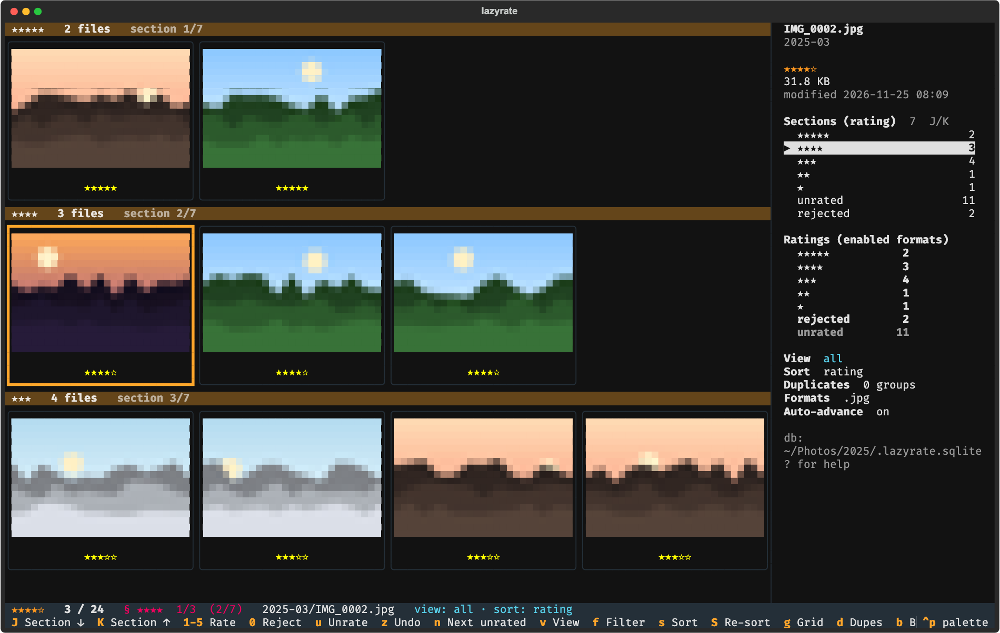

# lazyrate

Terminal UI to rate thousands of photos fast and keep only the best ones (e.g. for a year calendar).

## Why

A year of phone and camera photos easily means thousands of files spread over many folders, with bursts and
near-identical shots. Picking the twelve best for a calendar (or the fifty best for a photo book) in a file browser is
slow: you lose track of what you already looked at, and there is no place to keep the verdicts.

lazyrate turns this into a keyboard-only pass: one key per photo (`1`–`5` stars, `0` reject), previews right in the
terminal, ratings saved instantly in a small database next to the photos. Afterwards you review by rating (only the
5-star ones, only the unrated), weed out near duplicates, and export the keepers to a separate folder. Your photos
themselves are never touched.



<sub>Screenshot taken headless with generated demo images, so the thumbnails use the block-character fallback. In
terminals with a graphics protocol (Ghostty, Kitty, WezTerm, iTerm2) they are shown at full resolution.</sub>

## Features

- Recursively scans a folder (hidden folders and NAS metadata like `@eaDir` are skipped)
- Real image previews in the terminal: Kitty graphics protocol (Ghostty, Kitty, WezTerm), Sixel (iTerm2, foot, …), unicode fallback elsewhere
- Background decoding + prefetch of the next images, JPEG draft-mode decoding (24 MP → ~25 ms), EXIF orientation, HEIC/HEIF
- Ratings stored immediately in SQLite (`ROOT/.lazyrate.sqlite`), keyed by path relative to the root, so the folder can be moved
  (a `.imgrate.sqlite` from before the rename to lazyrate is renamed automatically, ratings are kept)
- Sort by path, rating (best first) or date taken
- Near-duplicate detection (bursts, re-saved or resized copies): perceptual hash computed once in the background
  and cached in SQLite; review one group at a time and keep the best with a single key
- Review any rating bucket (unrated, rejected, ≥ N stars, any combination) in single view or as a thumbnail grid
- Export from the app (`E`) or the shell, by copy or symlink, flat or with sub folders
- Choose which file formats take part (images on by default; `.mp4`, `.mov`, RAW etc. off unless you enable them)

## Install

```sh
uv tool install git+https://github.com/wrichert/lazyrate
# or, from a checkout
uv sync && uv run lazyrate ~/Pictures/2025
```

## Usage

```sh
lazyrate ~/Pictures/2025                       # rate (TUI)
lazyrate stats ~/Pictures/2025                 # counts per rating
lazyrate export ~/Pictures/2025 ~/calendar --min-rating 4 [--flat] [--symlink] [--dry-run]  # 4 and 5 stars
lazyrate export ~/Pictures/2025 ~/maybe --rating 3            # exactly 3 stars (repeatable; 0 = rejected)
lazyrate rate ~/Pictures/2025 --db ~/ratings.sqlite   # keep the DB elsewhere (e.g. read-only folder)
```

### Keys

| Key | Action |
| --- | --- |
| `1`–`5` | rate (auto-advances; toggle with `a`) |
| `0` / `x` | reject |
| `u` | clear rating |
| `z` | undo |
| `→` `l` `space` / `←` `h` | next / previous |
| `↓` `↑` | next / previous (grid: row) |
| `pgdn` `pgup` | jump 10 (grid: page) |
| `ctrl+↑` `ctrl+↓` (or `ctrl+k` `ctrl+j`, `home` `end`) | first / last |
| `J` / `K` | next / previous section (folder, rating, month or duplicate group, depending on sort); also `]` `.` / `[` `,` |
| `n` | next unrated |
| `v` / `V` | cycle view: all · unrated · not rejected · ≥★ … ★★★★★ · rejected |
| `f` | choose any combination of ratings to view |
| `s` | cycle sort: rating (best first, default) · date taken · path |
| `S` | re-sort / re-filter now (re-rated photos move to their new section) |
| `g` | toggle thumbnail grid (default) / single image (`enter` in the grid opens the highlighted image) |
| `d` | toggle duplicates mode (each group is a section) |
| `b` | duplicates mode: keep this one, reject the rest of the group, jump to next group |
| `E` | export: pick ratings, destination, flat / symlink (remembered for next time) |
| `e` | choose file formats |
| `o` | open in the system viewer (also for videos) |
| `c` | copy the full path to the clipboard |
| `r` | rescan folder |
| `?` | help |

### Near duplicates

Each image gets a 64-bit difference hash (grayscale 9×8 thumbnail). Two images are grouped when their hashes
differ in ≤ 10 bits and they were taken ≤ 15 minutes apart (EXIF capture time, else file time). This reliably
catches bursts, re-saved and resized copies; it misses the same scene with a different crop or zoom.
Indexing takes about 3–7 ms per photo, runs in the background on start, and is reused on later runs
(recomputed only for changed files).

### Sections

The list is split into sections depending on the sort order: folders (path), ratings (rating), months
(date taken) or duplicate groups. The grid shows a header line per section and starts each section on a new row;
`J`/`K` (or `]`/`.` and `[`/`,`) jump between sections, also in the single-image view. The sidebar lists the
sections around the current one with their sizes.

The app starts in the grid, sorted by rating. Within a view the list stays stable while you rate, so rating
doesn't make the cursor jump; press `S` to re-sort and re-filter (re-rated photos move to their new section).
Section counts are live: a section with re-rated photos waiting for `S` is marked with ↻.

### Suggested workflow for a calendar

1. Press `d` and `g`: go through the duplicate groups, `b` on the best shot of each burst.
   Press `d` again to leave.
2. View **unrated**, go through quickly: `x` for rejects, `3` for "maybe", `4`/`5` for good ones.
3. View **≥ ★★★★** in grid mode (`g`), compare, promote the best to `5`, demote the rest.
4. View **★★★★★ only**, `s` to sort by date taken (one section per month), until 12–13 remain, then `E` to export.

## Development

```sh
uv sync
uv run pytest
uv run ruff check . && uv run ruff format .
```

## Disclaimer

Use at your own risk. lazyrate only reads your photos and never deletes, moves or modifies them: ratings live in a
separate SQLite file and export copies or links files without overwriting existing ones. Still, this software comes
without any warranty, and the author accepts no liability for lost data or any other damage. Keep a backup of your
photos.

## License

MIT, see [LICENSE](LICENSE).
